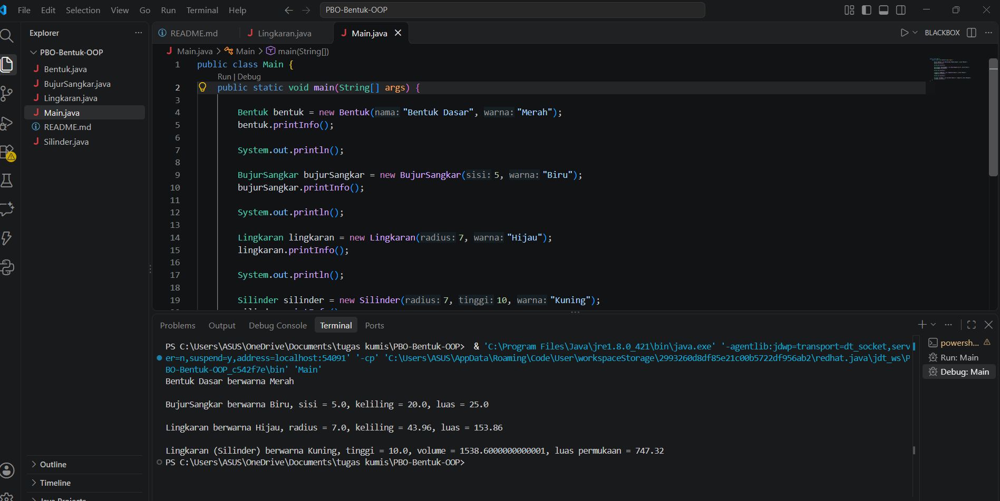

# PBO - 

Proyek Java sederhana yang mendemonstrasikan konsep **Object-Oriented Programming (OOP)**
menggunakan hierarki kelas bentuk geometri.

**Konsep yang diterapkan:** Encapsulation · Inheritance · Polymorphism

---

## Hierarki Kelas

```
Bentuk
 ├── BujurSangkar
 └── Lingkaran
      └── Silinder
```

---

## Deskripsi Kelas

### `Bentuk` *(Parent Class)*

Kelas dasar yang menyimpan atribut umum semua bentuk.

| Anggota                            | Return    | Keterangan                  |
| ---------------------------------- | --------- | --------------------------- |
| `nama` *(protected)*               | `String`  | Nama bentuk                 |
| `warna` *(protected)*              | `String`  | Warna bentuk                |
| `Bentuk(String nama, String warna)`| —         | Constructor                 |
| `getNama()`                        | `String`  | Getter nama                 |
| `getWarna()`                       | `String`  | Getter warna                |
| `setWarna(String)`                 | `void`    | Setter warna                |
| `printInfo()`                      | `void`    | Menampilkan info bentuk     |

---

### `BujurSangkar` *(extends Bentuk)*

Mewarisi `Bentuk`, menambahkan kalkulasi persegi.

| Anggota                                  | Return   | Keterangan                       |
| ---------------------------------------- | -------- | -------------------------------- |
| `sisi` *(private)*                       | `double` | Panjang sisi                     |
| `BujurSangkar(double sisi, String warna)`| —        | Constructor                      |
| `getSisi()` / `setSisi(double)`          | `double` | Getter / Setter sisi             |
| `hitungKeliling()`                       | `double` | `4 × sisi`                       |
| `hitungLuas()`                           | `double` | `sisi × sisi`                    |
| `printInfo()` *@Override*                | `void`   | Tampilkan sisi, keliling & luas  |

---

### `Lingkaran` *(extends Bentuk)*

Mewarisi `Bentuk`, menambahkan kalkulasi lingkaran.

| Anggota                                    | Return   | Keterangan                         |
| ------------------------------------------ | -------- | ---------------------------------- |
| `radius` *(private)*                       | `double` | Jari-jari lingkaran                |
| `PHI = 3.14` *(static final)*             | `double` | Konstanta π                        |
| `Lingkaran(double radius, String warna)`   | —        | Constructor                        |
| `getRadius()` / `setRadius(double)`        | `double` | Getter / Setter radius             |
| `hitungKeliling()`                         | `double` | `2 × PHI × radius`                 |
| `hitungLuas()`                             | `double` | `(PHI × d²) / 4`                   |
| `printInfo()` *@Override*                  | `void`   | Tampilkan radius, keliling & luas  |

---

### `Silinder` *(extends Lingkaran)*

Mewarisi `Lingkaran`, menambahkan dimensi tinggi untuk bangun 3D.

| Anggota                                          | Return   | Keterangan                                  |
| ------------------------------------------------ | -------- | ------------------------------------------- |
| `tinggi` *(private)*                             | `double` | Tinggi silinder                             |
| `PHI = 3.14` *(static final)*                   | `double` | Konstanta π                                 |
| `Silinder(double radius, double tinggi, String warna)` | — | Constructor                           |
| `getTinggi()` / `setTinggi(double)`              | `double` | Getter / Setter tinggi                      |
| `hitungVolume()`                                 | `double` | `PHI × r² × tinggi`                         |
| `hitungLuasPermukaan()`                          | `double` | `(2 × luasAlas) + luasSelimut`              |
| `printInfo()` *@Override*                        | `void`   | Tampilkan tinggi, volume & luas permukaan   |

---

## Konsep OOP yang Diterapkan

### 1. Encapsulation
Atribut disembunyikan dengan akses `private`/`protected`, diakses via getter & setter.

```java
private double sisi;

public double getSisi() { return sisi; }
public void setSisi(double sisi) { this.sisi = sisi; }
```

### 2. Inheritance
Kelas anak mewarisi kelas parent dengan `extends`, dan memanggil constructor parent via `super()`.

```java
public class BujurSangkar extends Bentuk {
    public BujurSangkar(double sisi, String warna) {
        super("BujurSangkar", warna);
        this.sisi = sisi;
    }
}
```

### 3. Polymorphism
Setiap kelas anak meng-*override* `printInfo()` sesuai informasi bentuknya masing-masing.

```java
@Override
public void printInfo() {
    System.out.println(getNama() + " berwarna " + getWarna()
            + ", sisi = " + sisi
            + ", keliling = " + hitungKeliling()
            + ", luas = " + hitungLuas());
}
```

---

## Cara Menjalankan

**Kompilasi:**
```bash
javac Bentuk.java BujurSangkar.java Lingkaran.java Silinder.java Main.java
```

**Jalankan:**
```bash
java Main
```

---

## Contoh Output

```
Bentuk Dasar berwarna Merah

BujurSangkar berwarna Biru, sisi = 5.0, keliling = 20.0, luas = 25.0

Lingkaran berwarna Hijau, radius = 7.0, keliling = 43.96, luas = 153.86

Lingkaran (Silinder) berwarna Kuning, tinggi = 10.0, volume = 1538.6, luas permukaan = 747.32
```

---

## Struktur File

```
PBO-Bentuk-OOP/
├── Bentuk.java         # Kelas parent (base class)
├── BujurSangkar.java   # Persegi, extends Bentuk
├── Lingkaran.java      # Lingkaran, extends Bentuk
├── Silinder.java       # Silinder 3D, extends Lingkaran
├── Main.java           # Entry point
└── README.md           # Dokumentasi
```


## 📸 Screenshot Hasil Program

Berikut merupakan tempat untuk menampilkan screenshot hasil eksekusi program.


